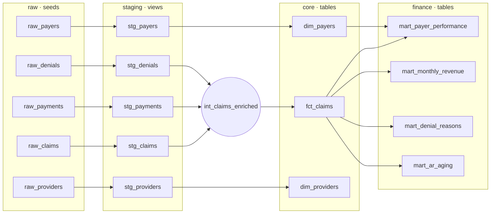

# Revenue dbt Warehouse

[](https://github.com/mprantikk/revenue-dbt-warehouse/actions/workflows/ci.yml)


An analytics-engineering project: a layered dbt warehouse that turns messy healthcare claims extracts into tested, documented revenue-cycle marts. It runs on DuckDB, so anyone can clone it and build the whole warehouse in a few seconds with no database server.

All data is synthetic, generated by a seeded script so every number below is reproducible.

## Architecture



| Layer | What happens |
|---|---|
| **Staging** | Deduplicates the extract (it ships with duplicate claim rows), normalises casing and whitespace in names and status codes, casts types, derives the CARC denial group |
| **Intermediate** | One ephemeral model that defines "paid", "denied", "clean claim", charge lag and days to payment once, so every mart agrees |
| **Core** | Claim-grain fact table and payer/provider dimensions |
| **Finance** | Payer scorecard, monthly revenue with rolling 3-month collection rate, denial dollars at risk, AR aging |

## Data quality: 52 tests on every build

- **Schema tests:** `unique`, `not_null`, `accepted_values`, `relationships` on every key
- **Custom generic tests:** `non_negative`, `not_after` (service date can't follow submission)
- **Business-rule tests:** every paid claim has a payment and no unpaid claim does; payers never pay above the allowed amount; every denial carries a CARC code
- **Reconciliation test:** collected dollars and claim counts must match between `fct_claims` and each mart

CI fails the build if any test fails, and also regenerates the seeds to prove they are reproducible.

## What the marts show

4,000 claims, 6 payers, 24 providers, 2024–2025.

| Payer | Type | Claims | Denial rate | Clean claim rate | Days to payment |
|---|---|---:|---:|---:|---:|
| Self Pay | Self-Pay | 315 | 29.3% | 57.3% | 75.1 |
| State Medicaid | Medicaid | 483 | 24.3% | 62.2% | 64.0 |
| Medicare Advantage One | Medicare | 390 | 19.7% | 66.2% | 56.1 |
| Medicare Part B | Medicare | 693 | 15.3% | 71.7% | 50.2 |
| United Care Plus | Commercial | 928 | 15.3% | 69.9% | 39.7 |
| BlueStar Health | Commercial | 1,191 | 12.0% | 70.8% | 35.9 |

- **$184.8K of billed charges were denied, and 88.9% of that is in contractual (CO) codes** the provider can fix. CO-16 (missing information) alone is $45.3K.
- **Late submission costs money:** claims sent more than 7 days after service are denied 23.9% of the time vs 16.5% for on-time claims (`analyses/late_submission_denials.sql`).
- Once paid, net collection is healthy at 95.0% of allowed across every payer, so the leakage is in denials and delay, not underpayment.

## Run it

```bash
git clone https://github.com/mprantikk/revenue-dbt-warehouse.git
cd revenue-dbt-warehouse
pip install -r requirements.txt
export DBT_PROFILES_DIR=.
dbt build                 # seeds + 13 models + 52 tests, about 3 seconds
dbt docs generate && dbt docs serve   # browse lineage and column docs
```

Query the result directly: `duckdb warehouse.duckdb "select * from finance.mart_payer_performance"`.

Moving to Snowflake or Postgres means changing `profiles.yml`; date arithmetic goes through the `days_between` macro, which already has a Postgres implementation.

## Project layout

```
├── models/
│   ├── staging/        5 views + tests
│   ├── intermediate/   int_claims_enriched (ephemeral)
│   └── marts/          core (fact + dims) and finance (4 marts) + tests
├── tests/              business-rule, reconciliation and custom generic tests
├── macros/             days_between (cross-database), title_case, schema naming
├── analyses/           ad-hoc questions answered from the marts
├── seeds/              synthetic raw extracts
└── scripts/            seeded data generator
```

Built by [Masud Parvej](https://mprantikk.github.io/).
